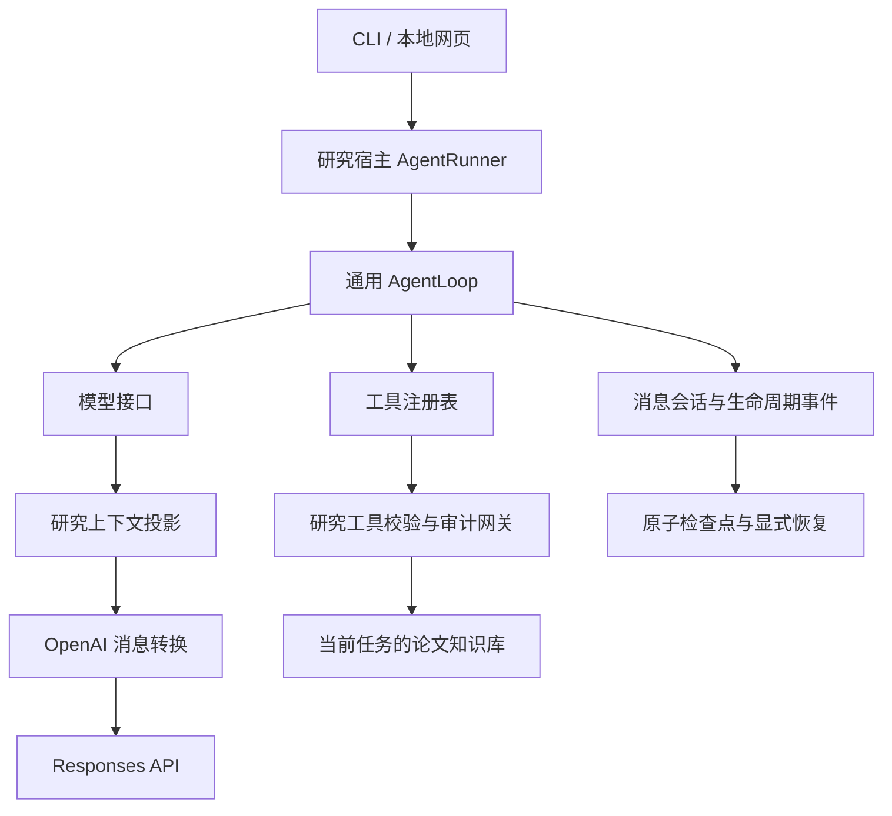

# Agent 结构与执行协议

本实现参考 [pi-agent-core 的消息、上下文与事件设计](https://github.com/earendil-works/pi/blob/main/packages/agent/README.md)，
采用适合当前项目的 Python 分层。代码独立实现，不直接依赖 pi 的 TypeScript 运行时。
参考日期：2026-10-25；参考链接指向上游 main，后续内容可能变化。

## 目录与职责

```text
agent/
├── core/               # 通用运行机制，不导入论文、RAG 或 OpenAI
│   ├── contracts.py    # 模型接口、返回值、用量与异常
│   ├── messages.py     # 消息类型、调用 ID 配对、会话与事件订阅
│   ├── tools.py        # 可执行工具声明与注册表
│   └── loop.py         # 请求 → 应用判定 → 工具执行 → 继续/结束
├── context.py          # 研究状态到模型上下文的有界投影
├── openai_client.py    # Agent 专用客户端与脱敏错误诊断
├── citations.py        # 对当前任务可见证据进行逐字引文校验
├── model.py            # OpenAI 适配、消息格式转换、请求预检
├── runner.py           # 研究应用宿主：预算、检查点、结束条件与纠正
├── state.py            # 可持久化研究会话、消息、事件与用量
├── tools.py            # 七个研究工具的参数校验、审计与执行网关
├── task.py             # 固定主题、日期、篇数与任务预算
└── workspace.py        # 当前任务的 PDF、正文索引、页面与来源绑定
```



通用核心的独立计算工具测试不导入 OpenAI、NumPy、Torch 或研究模块。
研究宿主实现 `LoopHost`：准备请求和预留预算、接收模型结果、检查工具调用、处理结果与结束。
工具注册表的执行器接入既有审计网关；参数校验在该网关完成，保证拒绝的调用也有记录。

## 与 pi 的设计对应

| pi 中的边界 | 本项目中的实现 |
| --- | --- |
| AgentMessage 与工具调用结果 | `AgentSession`，user / assistant / tool 消息，调用 ID 配对 |
| Agent loop 与应用 hooks | `AgentLoop` 调度，`LoopHost` 提供预算、持久化和完成规则 |
| 可执行工具声明 | `AgentTool` 与 `ToolRegistry`，研究工具继续使用审计网关 |
| transformContext / convertToLlm | `context.py` 的研究投影 / `model.py` 的 Responses 格式转换 |
| 生命周期事件和订阅 | agent / turn / message / tool_execution 事件，`subscribe()` |

这是一个同步、顺序执行的文献研究 Agent。现有网页通过轮询读取检查点；
事件订阅是生命周期通知，不是 token 级流式输出。本次没有移植 pi 的 TUI、RPC、插件、
多模型路由、消息队列或并行工具执行；也没有新增这些运行依赖。

## 模型真正接收的内容

每轮请求包含有界的当前研究上下文，以及最近一个适合保留的完整工具交换：

```text
user: 当前任务、候选状态、可见正文证据、预算和完成条件
function_call: 模型上一轮的调用，保留原 call_id 和参数
function_call_output: 同 call_id 的工具结果摘要或纠正反馈
→ 模型提出下一步
```

消息转换依据 [OpenAI 工具调用协议](https://developers.openai.com/api/docs/guides/function-calling)。
完整消息留在检查点中。发给模型时按完整调用/结果对裁剪；过大的旧调用参数会连同对应结果一起省略，
不发送孤立工具结果。结果摘要有明确标记，可引用的原文由当前上下文中的 evidence 提供。
每轮仍计算包含这些消息在内的整个请求预算；不发送全部历史或整份论文。

线上仍使用单个受控 `research_action` 函数表示研究动作。函数内部选择七个实际工具或提出结束，
实际执行经过注册表与审计网关；没有宣称已切换为七个并行的原生函数声明。
保留这一应用协议可以继续约束候选 ID、日期、选择说明和完成条件；工具调用及结果的消息配对则已标准化。

## 状态、事件与恢复

`runner_state.json` 原子保存领域状态、`messages` 和 `agent_events`。
`tool_trace.json` 仍是工具副作用与预算的审计依据，不能仅凭 transcript 自动重放动作。

- 模型请求前先保存 pending 和预留用量；未知调用结果保守计费并停止。
- 工具执行前保存 assistant 调用、调用 ID 与 pending；完成后保存配对结果和来源。
- 工具完成但宿主检查点未提交时，显式恢复依据已完成审计记录补齐消息，不重新执行工具。
- 提前结束的拒绝也是失败结果消息，模型下一轮可看到 `verify_citations` 纠正要求。
- 原步骤、费用、时限、重复动作和引用门槛均由研究宿主继续执行。
- 只检索当前研究任务的知识库；旧版默认 RAG 索引与独立问答入口已退役。

观察事件可使用：

```python
# research_tools 和 model_policy 按已有入口创建。
runner = AgentRunner(research_tools, model_policy)
unsubscribe = runner.subscribe(lambda event: print(event["type"]))
runner.run()
unsubscribe()
```

事件订阅者只收到副本，其异常不会重执行工具。前端状态接口返回事件和消息数量，不暴露完整 transcript。
CLI 与页面启动命令保持不变。运行协议和上下文版本已升级，请重启页面服务并创建新任务；旧任务保留只读，
不把旧状态静默改写成新协议。当前仍只生成短证据回答，正式研究报告尚未实现。
